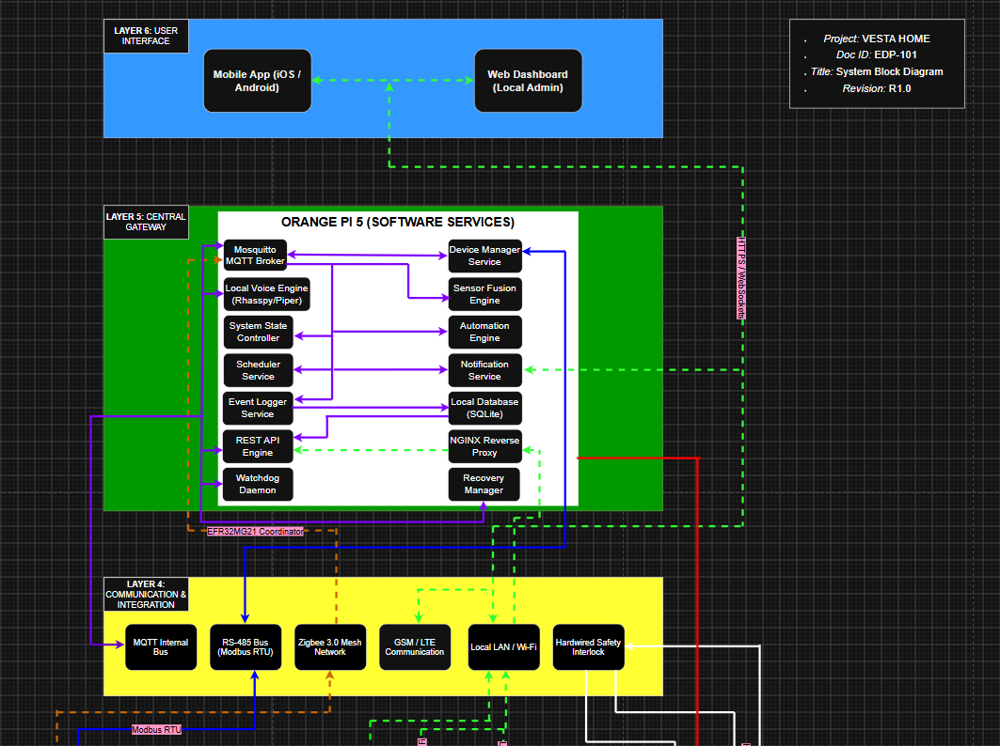
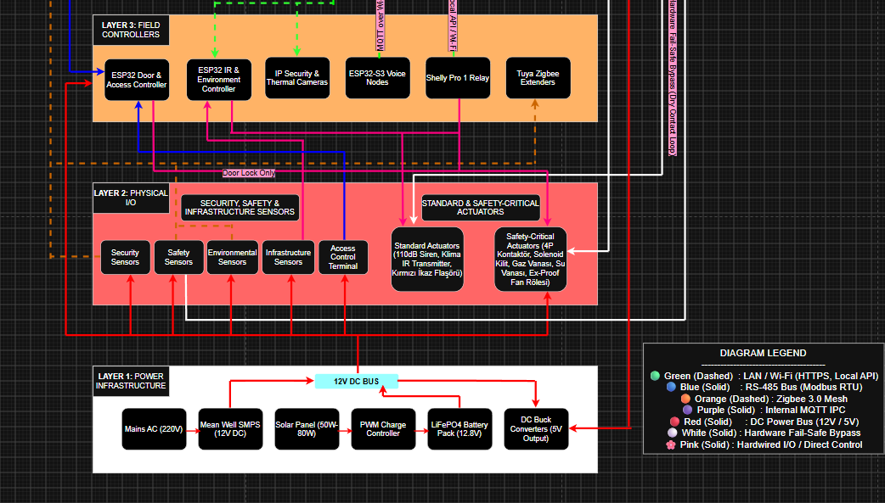
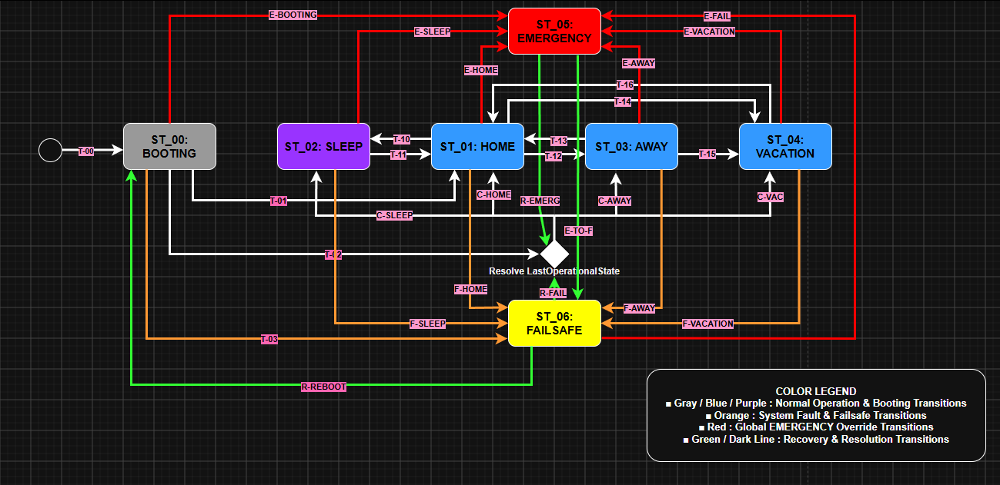

# VESTA HOME

Local-first smart-home and building-management concept · Personal Engineering Project · In Development

[Türkçe açıklama](README.tr.md)

## Project Overview

VESTA HOME is a modular smart-home and building-management project designed around local processing, privacy, and explicit operating scenarios. Its planned scope brings together access control, environmental monitoring, security, energy management, comfort automation, and local voice interaction.

The project is in development. The work presented here focuses on requirements, system architecture, state transitions, and operating scenarios. Initial software work has started; hardware integration and full-system validation remain future work.

## My Contribution

- Defined the project concept, functional requirements, and candidate component families.
- Prepared system block diagrams showing services, field controllers, sensors, actuators, and their connections.
- Documented the system state model, transition conditions, priorities, and recovery concepts.
- Developed operating scenarios and began initial software development.

## System Architecture

The following two images show the upper and lower sections of the R1.0 system block diagram, retained as an early design record. The **Web Dashboard** label reflects an earlier interface concept; the current user-facing scope is the mobile application and local voice interface. Device models and software components shown are development references.

*R1.0 architecture reference — user interfaces, local central services, and communication layers.*

*R1.0 architecture reference — field controllers, physical I/O, safety paths, and power infrastructure.*

## System State Model

The documented top-level states are **BOOTING, HOME, SLEEP, AWAY, VACATION, EMERGENCY, and FAILSAFE**. The design priority is **EMERGENCY > FAILSAFE > normal operation**.

The diagram provides an overview. Detailed transition conditions and actions are recorded in the engineering matrix; scenario refinement is ongoing.

## Current Engineering Work

| Area | Current status |
|---|---|
| Product definition and initial requirements | Documented |
| High-level architecture and state model | Documented; revisions continue |
| Operating scenarios | In progress |
| Software | Initial development started |
| Hardware integration and system verification | Planned |

## Architecture Technologies Under Consideration

Orange Pi-class local controller · ESP32-family field nodes · MQTT · RS-485 / Modbus RTU · Zigbee · local LAN / Wi-Fi · local voice processing

These describe the proposed architecture, rather than a completed or validated implementation.

## Portfolio Scope

This showcase contains selected diagrams and summary documentation. Full requirements, detailed transition matrices, the complete roadmap, source code, and editable engineering files remain outside this public repository.
