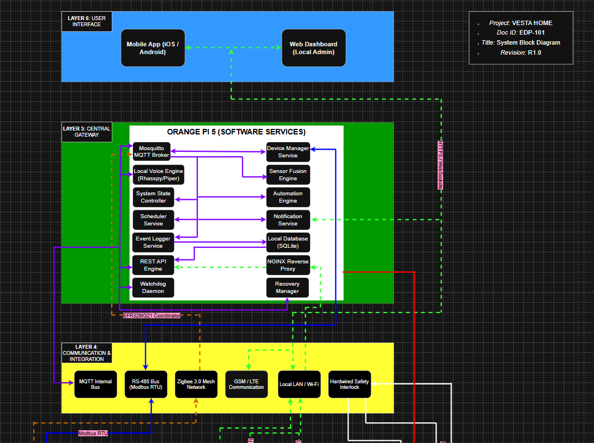
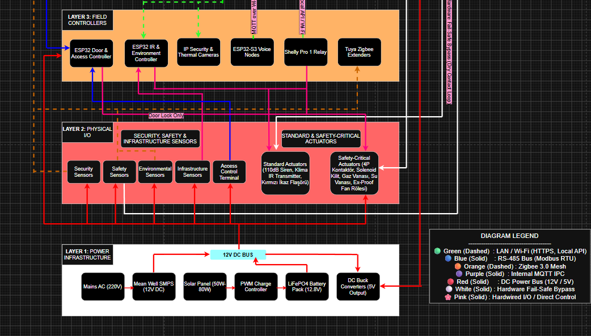
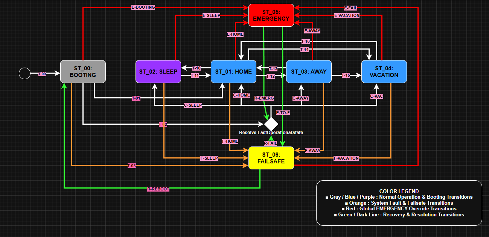

# VESTA HOME

Yerel çalışmayı esas alan akıllı ev ve bina yönetimi konsepti · Kişisel Mühendislik Projesi · Geliştirme Aşamasında

[English version](README.md)

## Proje Özeti

VESTA HOME; yerel işleme, gizlilik ve açıkça tanımlanmış çalışma senaryoları üzerine tasarlanan modüler bir akıllı ev ve bina yönetimi projesidir. Planlanan kapsam; erişim kontrolü, çevresel izleme, güvenlik, enerji yönetimi, konfor otomasyonu ve yerel sesli etkileşimi bir araya getirir.

Proje geliştirme aşamasındadır. Burada sunulan çalışmalar gereksinimlere, sistem mimarisine, durum geçişlerine ve çalışma senaryolarına odaklanır. İlk yazılım çalışmalarına başlanmıştır; donanım entegrasyonu ve bütün sistemin doğrulanması ileriki aşamalardadır.

## Projedeki Katkım

- Proje konseptini, işlevsel gereksinimleri ve aday bileşen gruplarını belirledim.
- Servisleri, saha kontrolörlerini, sensörleri, aktüatörleri ve aralarındaki bağlantıları gösteren sistem blok diyagramlarını hazırladım.
- Sistem durum modelini, geçiş koşullarını, öncelikleri ve kurtarma yaklaşımlarını belgeledim.
- Çalışma senaryolarını geliştirdim ve ilk yazılım geliştirme çalışmalarına başladım.

## Sistem Mimarisi

Aşağıdaki iki görsel, ilk tasarım kaydı olarak korunan R1.0 sistem blok diyagramının üst ve alt bölümlerini gösterir. **Web Dashboard** etiketi önceki bir arayüz fikrini yansıtır; güncel kullanıcı arayüzü kapsamı mobil uygulama ve yerel sesli arayüzdür. Gösterilen cihaz modelleri ve yazılım bileşenleri geliştirme referanslarıdır.

*R1.0 mimari referansı — kullanıcı arayüzleri, yerel merkezi servisler ve haberleşme katmanları.*

*R1.0 mimari referansı — saha kontrolörleri, fiziksel giriş/çıkışlar, güvenlik yolları ve güç altyapısı.*

## Sistem Durum Modeli

Belgelenmiş üst seviye durumlar **BOOTING, HOME, SLEEP, AWAY, VACATION, EMERGENCY ve FAILSAFE** olarak tanımlanmıştır. Tasarım önceliği **EMERGENCY > FAILSAFE > normal çalışma** şeklindedir.

Diyagram genel görünümü sunar. Ayrıntılı geçiş koşulları ve eylemler mühendislik matrisinde kayıtlıdır; senaryo geliştirme çalışmaları devam etmektedir.

## Mevcut Mühendislik Çalışmaları

| Alan | Mevcut durum |
|---|---|
| Ürün tanımı ve başlangıç gereksinimleri | Belgelenmiş |
| Üst seviye mimari ve durum modeli | Belgelenmiş; revizyonlar sürüyor |
| Çalışma senaryoları | Devam ediyor |
| Yazılım | İlk geliştirme çalışmalarına başlandı |
| Donanım entegrasyonu ve sistem doğrulaması | Planlanıyor |

## Mimaride Değerlendirilen Teknolojiler

Orange Pi sınıfı yerel kontrolör · ESP32 ailesi saha düğümleri · MQTT · RS-485 / Modbus RTU · Zigbee · yerel LAN / Wi-Fi · yerel ses işleme

Bu liste, tamamlanmış veya doğrulanmış bir uygulamadan ziyade önerilen mimariyi tanımlar.

## Portföy Kapsamı

Bu tanıtım alanında seçilmiş diyagramlar ve özet açıklamalar bulunur. Tam gereksinimler, ayrıntılı geçiş matrisleri, yol haritasının tamamı, kaynak kod ve düzenlenebilir mühendislik dosyaları bu açık depoya dâhil değildir.
